  
  
  
  
  

I co-founded **[LayeredAI](https://layeredai.us)**, a forward-deployed AI firm in New York. We build production LLM, RAG, and agentic systems for teams of 20 to 500 people. I design them, build them, and keep them running after launch. On the side I do research on how tokenizers handle morphologically dense languages.

## Now

- **Published:** [*Fewer Words, Not Fewer Tokens: Measuring the Sanskrit Tokenization Penalty per Proposition*](https://arxiv.org/abs/2609.12960) on arXiv. Code and every number are in [sanskrit-token](https://github.com/DS436/sanskrit-token).
- **Building at LayeredAI:** production AI systems for mid-market teams, with eval harnesses, guardrails, and cost controls built in from day one.
- **Live side projects:**
  - [SchedulerAI](https://scheduler-ai-gamma.vercel.app) (private beta): a daily time ledger that turns calendar, goals, and WHOOP recovery into an AI morning brief.
  - [Paperbot](https://paperbot-kappa.vercel.app): an AI paper-trading copilot for Polymarket where a person approves every trade.
  - [Rain Padel](https://rain-padel.vercel.app): runs a social padel night from one phone.

  SchedulerAI and Paperbot keep their repos private, so their cards link to the live apps.

## Featured work

  
  

  
  

  
  

## What I work on

| Area | What that means in practice |
|---|---|
| **Agentic AI** | Multi-step, tool-using agents with review gates and evals, built to run in production |
| **RAG** | Hybrid retrieval, reranking, chunking, citations, and faithfulness evals |
| **Context engineering** | System prompts, memory, structured outputs, tool schemas |
| **AI security** | Prompt injection defense, PII handling, RBAC for retrieval, audit logs |

## Stack

Provider-agnostic: Claude, GPT, and Gemini where quality matters most; open weights (Llama, Qwen, DeepSeek) served through Groq, OpenRouter, or self-hosted when data has to stay put or cost has to drop.

<b>Earlier projects</b>

 

| Repo | What it is |
|---|---|
| [Resume_Parser-AI](https://github.com/DS436/Resume_Parser-AI) | Structured entity extraction from unstructured resumes |
| [Skin-Cancer-Detection-System-](https://github.com/DS436/Skin-Cancer-Detection-System-) | PFW senior capstone: image recognition with an explanatory chatbot layer |
| [Intelligent-Personalized-Learning-Platform](https://github.com/DS436/Intelligent-Personalized-Learning-Platform) | React and TensorFlow app with personalized content recommendations |
| [FITNESS_TRACKER](https://github.com/DS436/FITNESS_TRACKER) | Node, Express, and MongoDB tracker with Chart.js dashboards |

